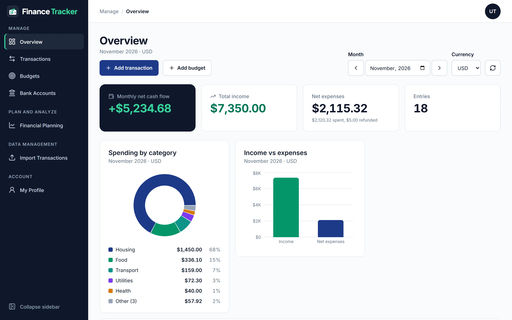
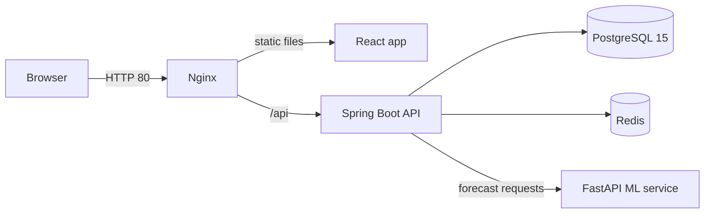

# Finance Tracker

[](https://github.com/NDT2000/Finance-Tracker/actions/workflows/ci.yml)

A full-stack personal finance application: track income and expenses, set monthly category budgets with machine-learning month-end estimates, import bank CSV files reliably, and plan what-if scenarios for the months ahead.

It is a personal and portfolio project, built to learn production-style engineering. It uses no paid services or API keys.



<sub>Screens show sample data.</sub>

## Features

- **Overview:** monthly net cash flow, income and net expenses for one month and currency, spending by category, recent entries, budget status and import freshness.
- **Transactions:** manual and imported income, expenses and refunds in one ledger. Filter by month, currency, type, account or source, and download any month as CSV.
- **Budgets with ML forecasts:** a monthly limit per category with exact amounts spent and left. A Python model estimates each category's month-end spending and flags the ones projected to go over.
- **Bank Accounts:** named account labels (type and currency) for grouping transactions. They are labels only, not live bank connections. Deleting one keeps its transactions' history.
- **Import Transactions:** CSV upload with durable background processing. It shows partial success clearly (rejected rows with reasons, downloadable as a report) and includes duplicate and overlap review, source revisions, refunds, import history and freshness.
- **Financial planning:** saved what-if scenarios over 1 to 36 months, with salary, spending, investment, loan and withdrawal events, cash-reserve and funding checks, and projections. Scenarios never touch the real ledger.
- **Accounts and security:** JWT authentication with refresh-token rotation, BCrypt password hashing, rate-limited sign-in, per-user data isolation, and password changes that sign out every device.
- **Interface:** a public landing page, responsive layouts from phone to desktop, light and dark themes, and WCAG 2.2 AA colour contrast checked by automated tests in both themes.

## Architecture



| Service | Technology | Role |
|---|---|---|
| Frontend | React 19, Vite, React Router, Recharts, Lucide icons | Single-page app built into static files and served by Nginx |
| Nginx | Nginx | Serves the frontend, proxies `/api` to the backend, sets security headers (CSP and others). Optional TLS setup. |
| Backend | Java 17, Spring Boot 3.2, Spring Security, Spring Data JPA, Flyway | REST API, authentication, ownership checks, financial calculations, import pipeline, forecast orchestration |
| ML service | Python 3.11, FastAPI, scikit-learn | Month-end spending estimate per category, called by the backend over HTTP |
| Database | PostgreSQL 15 | Users, transactions, budgets, bank-account labels, import batches and plans. Schema managed by Flyway migrations. |
| Cache | Redis 7 | Sign-in rate limiting |

Everything runs with Docker Compose. Only Nginx is exposed.

## Getting started

**Requirements:** Docker with Docker Compose.

1. Create your private settings file from the example:
   ```powershell
   Copy-Item .env.example .env
   ```
   Fill in the values. `JWT_SECRET` must be at least 64 hexadecimal characters; generate one with:
   ```powershell
   python -c "import secrets; print(secrets.token_hex(32))"
   ```
2. Build and start everything:
   ```powershell
   docker compose up -d --build
   ```
3. Open **http://localhost** and create an account. The backend needs a little while to start, so a `502` right after starting means "wait a moment".

**Frontend development with hot reload:** `docker-compose.dev.yml` also exposes the backend (8080), ML service (8000), PostgreSQL (5432) and Redis (6379) on `127.0.0.1`. Start the stack with both files, then run the Vite dev server, which proxies `/api` to port 8080:

```powershell
docker compose -f docker-compose.yml -f docker-compose.dev.yml up -d --build
cd frontend; npm install; npm run dev
```

Then open http://localhost:5173. If another PostgreSQL already uses port 5432 on your machine, stop it or use only the base file.

## Tests and CI

| Part | Command (from its folder) |
|---|---|
| Frontend | `npm run lint`, `npm test`, `npm run build` |
| Backend | `./mvnw -B verify` (Docker must be running: integration tests start real PostgreSQL and Redis containers) |
| ML service | `python -m unittest discover -p "test_*.py"` |

GitHub Actions runs all of these on every pull request and push to `main`, along with a secret scan (Gitleaks) and dependency vulnerability checks (OSV-Scanner and Dependabot alerts). It needs no repository secrets. See [docs/ci.md](docs/ci.md).

## Documentation

| Document | What it covers |
|---|---|
| [Learning guide](docs/learning-guide.md) | Start here: how a record moves through the system, and the concepts used |
| [Frontend architecture](docs/frontend-architecture.md) | Styling and themes, routing, shared components, each page |
| [Design system](docs/design-system.md) | Product and design specification the interface follows |
| [Financial planning](docs/financial-planning.md) | Planning engine with a hand-worked example |
| [Import pipeline](docs/pipeline/README.md) | CSV contract, processing model, operations, verification |
| [Bank transactions and export](docs/bank-transactions-and-export.md) | Account labels on transactions and the CSV report |
| [CI](docs/ci.md) | Every CI job and how to run it locally |
| [Security hardening](docs/security-hardening.md) and [SECURITY.md](SECURITY.md) | Security measures, production configuration, reporting a vulnerability |
| [Refund type fix](docs/refund-type-fix.md) | A schema fix (Flyway V7) and the backup procedure used |

## Roadmap

- **Done:** the full interface redesign (all pages, dark mode, accessibility) and the keyless CI pipeline.
- **Next:** small backend fixes and a Spring Boot upgrade.
- **Then:** **Ask AI**, an assistant that answers questions about your figures and how they are calculated, using open-source models that run locally. It never gets database access: facts come only from the existing authorized APIs. Without a model it still answers from a curated knowledge document.
- **Later:** a free deployment for showcasing the project, and a guided walkthrough of the whole codebase.

## Known limitations

- The forecast model (linear regression on the current month) is deliberately simple; the project focuses on the architecture around it.
- Editing a transaction whose bank account was deleted clears its historical account label. The form warns first; a backend fix is planned.
- There is no public deployment yet.

## Contributing

Suggestions and bug reports are welcome through [GitHub Issues](https://github.com/NDT2000/Finance-Tracker/issues/new/choose). For code changes, fork the repository and open a pull request to `main`; see [CONTRIBUTING.md](CONTRIBUTING.md). The owner reviews and merges changes manually.
