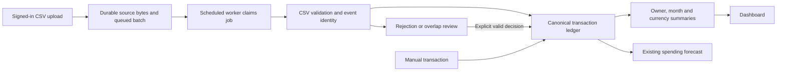

# Finance Tracker: project goal and learning guide

## The goal we completed

Build a local application where a signed-in user can record expenses or upload CSV exports, inspect validation/results, safely repeat imports, resolve overlaps and corrections/refunds, and see accurate monthly/category summaries without double counting. Preserve the existing profile, budgets and forecasting.

The five pipeline phases were merged into main through PR #21. The learning guide and compatible React/React DOM follow-up are on `feat/reliable-batch-pipeline` for your manual review. This is a local development milestone, not a production deployment claim. Cloud hosting, NVD credentials, large framework/runtime migrations and deployment hardening are separate release work, not prerequisites for the pipeline demo.

| Phase | What you can use | Verification |
| --- | --- | --- |
| 0 — Baseline | Existing application reproduced; migrations and configuration inspected | 77 original backend tests, actual API/ML demo, verified backup restore |
| 1 — Reliable imports | Upload/status/history, immutable source download, row outcomes/rejections, repeat protection and recovery | PostgreSQL tests, concurrent upload/worker tests, rollback/retry/lease tests |
| 2 — Trusted model | Stable event IDs, revisions, explicit overlap review, refunds, exact amounts and separate currencies | Hand sample reconciled to USD 40.00 expenses, USD 100.00 income, EUR 7.50 separately |
| 3 — Product integration | Authenticated uploads/results/review, dashboard month/currency and freshness, profile/manual entries/budgets/forecasting | Actual API and Chromium workflow plus retained security/profile tests |
| 4 — Operations | Simple scheduled worker, durable queue, bounded retries, dependent promotion, sequential backfills, logs/metrics | 1,000-row dataset measured; exact repeat keeps totals/counts |

## What the application shows

- Dashboard: selected month and currency; income, expenses net of refunds, net savings, refunds, category spending, budgets, daily trend and recent canonical entries. Current-month budgets retain ML forecasts. Net savings is a monthly flow, not a bank balance.
- Batch imports: upload/account namespace, upload progress, queued/processing state, history, row results, errors, overlap decisions, exact source download, rejected JSON and retry/re-evaluation.
- Profile: a two-option menu for read-only personal details/password change and multiple saved bank accounts with add/delete controls. Existing authentication and ownership controls remain.
- Freshness: query time, latest committed import and pending/review/failed import counts. These describe ingestion state, not proof a bank export contains every latest transaction.

## Follow one record through the system

The important decision is that **manual and imported entries feed one ledger**. Source rows describe where records came from; they are never added to totals a second time. The Day 1 synthetic raw/analytics demo is retained separately and excluded from product summaries.

## A small acceptance walkthrough

Use a fresh synthetic user to make the totals easy to check. Use the existing setup and keep credentials in the ignored `.env`. Before V4 runs against an existing database, follow the verified-backup instructions in [operations](pipeline/operations.md); don't recreate/delete its volume.

1. Register/sign in, open the profile and confirm your details.
2. In the dashboard select October 2026, USD. Add Coffee, Food, EXPENSE, 10.00, dated 2026-10-03.
3. Open Batch imports, account `sample`; upload `pipeline/data/product/01-expenses.csv`. Inspect its intentionally rejected amount and link the Coffee row to your manual entry.
4. Upload `02-corrections.csv`. Groceries revision 2 changes its original expense to 35.00; the return is a 10.00 refund, not another expense.
5. Refresh October/USD: income 100.00, gross expenses 50.00, refunds 10.00, net expenses 40.00, net savings 60.00, 5 canonical entries. Food net 35.00, Transport 5.00.
6. Select EUR: train expense 7.50, one separate entry. No combined USD/EUR total exists.
7. Re-upload both files in the same account. Existing batch IDs, counts and totals stay unchanged. Download the original/rejection report to inspect provenance.
8. Add an October/USD Food budget and inspect its current-month forecast when the ML service is running. Only active current-month entries in that currency feed it; refunds reduce spending and income does not count as spending.
9. Optional operations demo: generate and import the 1,000-row September fixture using the documented Python CLI, then repeat it. See [measurement and commands](pipeline/verification.md).

## Concepts used, and what to learn first

| Concept | Plain meaning | Where it appears |
| --- | --- | --- |
| HTTP/API and multipart requests | Browser sends a request; server validates and returns a status/result | Upload, status/results, profile and dashboard routes |
| Authentication vs authorization | Identify the user, then verify they own the requested data | Protected routes and owner-scoped queries |
| Relational data and foreign keys | Tables relate users, transactions, batches, rows and refund parents | PostgreSQL model/Flyway V4 |
| Schema migration | Versioned SQL changes the database without recreating existing data | Flyway; Hibernate `validate` checks compatibility |
| File contract and validation | Agree on columns/types/limits; explain data that doesn't satisfy them | CSV parser and rejected rows |
| Exact decimal arithmetic | Store money without binary floating-point rounding | BigDecimal and PostgreSQL numeric; explicit currencies |
| Idempotency | Repeating an operation has the same effect as doing it once | Owner/account/content hash and unique constraints |
| Event identity | Identify the same real transaction across different exports | Stable source ID plus account/user; source revision |
| Provenance | Preserve the source and decisions that explain a result | Immutable bytes, record numbers and outcomes |
| Database transactions | Commit related changes together or roll all of them back | Atomic promotion and failure recovery |
| Concurrency and locks | Prevent simultaneous writers from making conflicting decisions | Unique batch identity, owner lock, SKIP LOCKED claims |
| Review instead of guessing | Matching values alone don't prove two rows are the same event | LINK, KEEP_BOTH and IGNORE |
| Corrections and refunds | A revised event replaces its fields; a refund is a separate linked credit | Revision comparison and bounded refund totals |
| Soft deletion/tombstones | Exclude a record while remembering it, so reruns don't resurrect it | Exclusion and explicit restore |
| Aggregation and analytical grain | Define exactly what one result represents before summing | One owner/month/currency; category/day summaries |
| Reconciliation | Compare calculated totals against a hand-worked example | The sample's USD 40.00/EUR 7.50 totals |
| Durable job queue and scheduling | Store work in the DB and let a simple worker process it | Batch records and Spring scheduled polling |
| Retry, backoff and lease | Recover failed/stalled work without infinite retries or competing owners | Three attempts, delayed retry, claim tokens/expiry |
| Backfill and dependencies | Process earlier files in a defined order; resolve parents before children | Sequential CLI and expense-before-refund promotion |
| Freshness and observability | Show ingestion state and evidence about execution | Queue counts, timestamps, structured logs/duration |
| Unit vs integration vs browser tests | Check a component, real service interactions, then the user journey | Python/frontend tests, PostgreSQL/Testcontainers, Chromium |
| Regression forecasting | Estimate future spending from past observations; it is not an accounting total | Retained Python/scikit-learn service |
| Git feature branches and PR review | Save work separately and manually review it before main changes | Current feature branch and your main merge workflow |

Learn in this order:

1. Trace one CSV row and understand the HTTP request, tables and validation.
2. Work through SQL totals, BigDecimal/currency and the hand reconciliation.
3. Repeat files and compare file identity with real event identity; try an overlap/correction/refund.
4. Learn commit/rollback, unique constraints and why concurrent imports need locks.
5. Trigger a rejected row and retry; then study the queue, claim/lease and backfill order.
6. Read the tests and relate each assertion to a real failure it prevents.
7. Study the forecast separately: a prediction can be approximate while accounting remains exact.

Docker/Compose is useful to run the local components. Redis supports the existing authentication/rate-limit/session features; it is not the pipeline queue. Advanced cloud hosting, production certificates, dependency scanners and secret-rotation processes can wait until a separate deployment milestone. Do not disable existing checks merely to obtain a green badge.

## Practical limits

Stable source IDs allow automatic identity across exports. Unidentified overlapping exports require explicit review; the system does not guess. There is no FX conversion, financial-account balance reconciliation, streaming or external orchestration framework. Imported data has a defined CSV contract rather than automatic support for every bank format. Historical records default to USD to preserve the previous dollar-based app behavior; real historical currency correctness needs review.

Local functional evidence is recorded in [verification](pipeline/verification.md). Production deployment, GitHub CI approval and the existing NVD-key/historical-secret gates remain separate and unverified. Completing the local goal does not imply these release requirements are complete.
